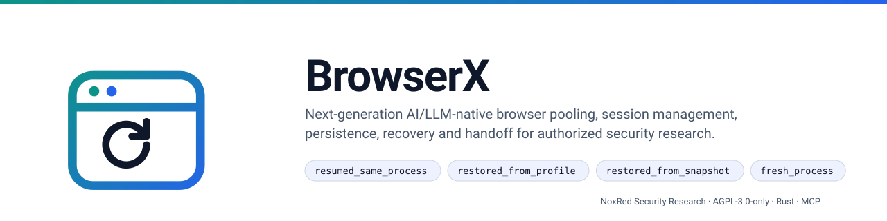
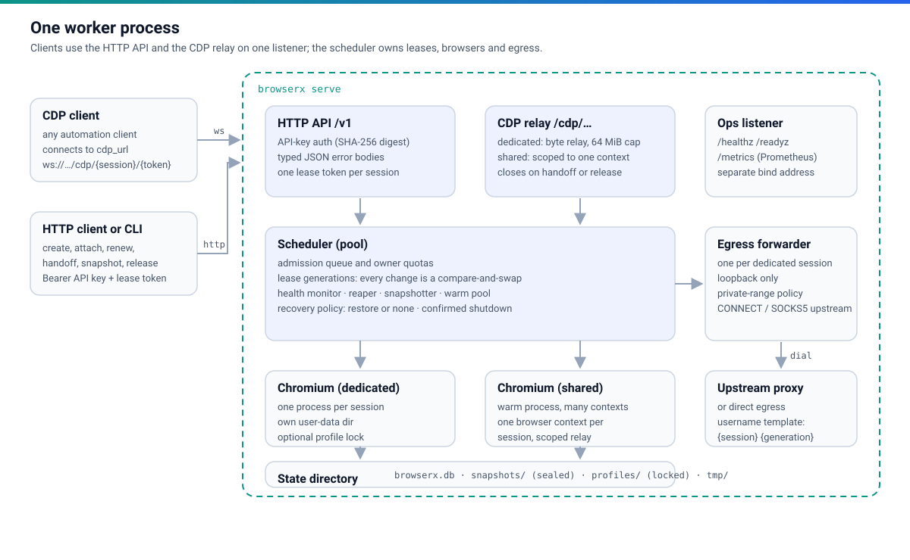

<div align="center">

<picture>
  <source media="(prefers-color-scheme: dark)" srcset="docs/assets/banner-dark.svg">
  
</picture>

**Open-source browser pooling, session management, persistence, recovery and handoff.**

One Rust service supervises local Chromium processes, leases them to automation clients as sessions, keeps the state you ask it to keep, replaces browsers that die, and moves control of a live session from one client to another, with an explicit answer to the question every client has: what survived?

[](LICENSE) [](https://github.com/noxred-research/browserx/actions/workflows/ci.yml) [](CHANGELOG.md) [](rust-toolchain.toml) [](CONTRIBUTING.md) [](SECURITY.md)

[What it is](#what-is-browserx) · [Core idea](#the-core-idea-three-different-contracts) · [Features](#features) · [Architecture](#architecture) · [Quick start](#quick-start) · [API](#api-at-a-glance) · [Configuration](#configuration) · [Observability](#observability) · [Responsible use](#responsible-use-and-security) · [Docs](#documentation)

</div>

> [!IMPORTANT]
> **Authorized use only.** BrowserX is for operating browsers and network egress that you own or are permitted to operate, against sites and services you are permitted to automate. It makes no promise about how a target site treats a browser it runs, and it is not a tool for evading protections, abusing third-party services or attacking anyone. See [Responsible use and security](#responsible-use-and-security).

> **Status:** pre-1.0 (`0.1.0-dev`). Interfaces, configuration keys, on-disk formats and the HTTP API can still change between minor versions, and the [changelog](CHANGELOG.md) lists what changed. The distribution is this repository and tagged source releases; no prebuilt binaries or images are published, so build from source or with the provided Dockerfile.

## What is BrowserX

BrowserX is a single worker process, written in Rust, that turns a machine with Chromium installed into a managed browser service.

- **Pooling.** It launches and supervises Chromium processes, keeps a warm pool of shared browsers if you want one, and admits session requests through a bounded queue with per-owner quotas and a deadline.
- **Session management.** A session is a *lease*: an identity, an owner, a time-to-live, a fencing generation and a controller token. Leases are stored in SQLite and every change is a compare-and-swap, so two writers can never both win.
- **Persistence.** You choose exactly what outlives the browser process: nothing (`ephemeral`), encrypted cookie and storage snapshots (`snapshot`) or a locked profile directory (`profile`). There is no boolean "persistent" flag, because each mode is a different engineering contract.
- **Recovery.** A health monitor notices a dead or unresponsive browser, launches a replacement, restores what the persistence mode kept and tells the next client exactly what happened.
- **Handoff.** Control of a live session moves to a new client with one call. The generation increments, the old token and any relay connection bound to it stop working, and the browser keeps running.

Any client that speaks the Chrome DevTools Protocol over a WebSocket attaches through the authenticated relay: automation libraries, crawlers, your own tooling.

## The core idea: three different contracts

"Resume my browser" can mean three different things. Treating them as one is how automation systems lose logins, replay the wrong state or silently start from nothing. BrowserX keeps them apart and reports which one you got, on **every attach**, as an `outcome`:

| `outcome` | What happened | What you can rely on |
| --- | --- | --- |
| `resumed_same_process` | You reconnected to the **live** browser process. | Everything: open pages, JavaScript heaps, sockets, in-flight requests. Only the controller changed. |
| `restored_from_profile` | A **new** process was launched on the **same profile directory**. | What Chromium keeps on disk: cookies, `localStorage`, IndexedDB, cache. Not open pages, JavaScript heaps or sockets. One worker, one browser at a time. |
| `restored_from_snapshot` | A **new** process was launched and an encrypted **snapshot was replayed** into it. | Cookies and the `localStorage` of the origins that were open, plus the page URLs, reopened. Portable across workers. Not heaps, sockets, service workers, cache or origins never opened. |
| `fresh_process` | A **new, empty** browser. | Nothing was restored. Treat the session as new. |

A client that sees anything other than `resumed_same_process` knows to re-establish page state before it continues. See [Persistence](docs/design/persistence.md) and [Recovery](docs/design/recovery.md) for the exact contracts.

## Features

| Capability | What you get |
| --- | --- |
| **Dedicated and shared isolation** | One Chromium process per session, or one browser context per session inside a warm shared browser. Shared sessions only ever receive a scoped relay that refuses cross-context commands. See [isolation and security](docs/design/isolation-and-security.md) |
| **Leases with fencing** | Time-to-live with renewal, an absolute lifetime cap, an idle timeout, per-owner quotas, and a generation counter that fences every ownership change: allocation, recovery, handoff |
| **Admission control** | Bounded FIFO queue with a deadline; `429 capacity` instead of unbounded waiting |
| **Persistence modes** | `ephemeral`, `snapshot` (AES-256-GCM sealed, versioned, pruned, key-rotatable) and `profile` (0700 directory under an exclusive lock) |
| **Recovery** | Health probes with strikes, relaunch with bounded attempts, startup reconciliation after a worker crash, `recovery = "none"` when you would rather lose the session than replace it |
| **Handoff** | Token rotation with generation fencing; the old controller is cut off |
| **Egress** | A loopback forwarder per dedicated session in front of the browser: direct dialing with a private-range block, or an upstream `http://`, `https://`, `socks5://` or `socks5h://` proxy with credentials kept out of browser flags and logs, and `{session}` / `{generation}` username templates for sticky exits. See [egress](docs/design/egress.md) |
| **Launch profiles** | Named launch configurations: your own Chromium executable, extra flags, headless or headed. See [launch profiles](docs/guides/launch-profiles.md) |
| **HTTP API and CLI** | JSON API with typed errors, and `browserx session create\|list\|get\|attach\|renew\|handoff\|snapshot\|release` |
| **Operations** | Separate ops listener with `/healthz`, `/readyz` and Prometheus `/metrics`; graceful drain on SIGINT/SIGTERM with final snapshots and confirmed browser shutdown. See [operations](docs/guides/operations.md) |

## Architecture

<p align="center">
  <picture>
    <source media="(prefers-color-scheme: dark)" srcset="docs/assets/architecture-dark.svg">
    
  </picture>
</p>

The workspace is split by responsibility:

| Crate | Responsibility |
| --- | --- |
| `browserx-core` | Identifiers, session spec, lease record and state machine, snapshot format, storage and runtime traits, typed errors |
| `browserx-cdp` | Bounded Chrome DevTools Protocol client |
| `browserx-runtime` | Chromium process supervision, launch profiles, profile locks, state capture and restore |
| `browserx-egress` | Per-session loopback forwarder and destination policy |
| `browserx-store` | SQLite lease registry, sealed snapshot files, the snapshot sealer |
| `browserx-pool` | Scheduler: admission, allocation, renewal, expiry, recovery, handoff |
| `browserx-server` | HTTP API, CDP relay, ops endpoints, metrics |
| `browserx` | The binary: `serve`, `doctor`, key tools and the client commands |

Read the [architecture overview](docs/design/architecture.md) for how a request flows through them.

## Quick start

You need a Rust toolchain (the version in [`rust-toolchain.toml`](rust-toolchain.toml); `rustup` installs it) and a Chromium executable on `PATH` or named by `BROWSERX_CHROMIUM_PATH`.

```sh
cargo build --release

# 1. Check that this machine can run browsers.
target/release/browserx doctor

# 2. Create an API key. The key is printed once, with the config snippet holding its digest.
target/release/browserx keys new dev

# 3. Create the snapshot encryption key (mode 0600, refuses to overwrite).
target/release/browserx snapshot-key new ./.browserx-keys/snapshot.key

# 4. Put the printed [[auth.api_keys]] snippet into browserx.toml, then start the worker.
target/release/browserx serve --config browserx.toml
```

Create a session and use it from any CDP client:

```sh
export BROWSERX_SERVER=http://127.0.0.1:7690
export BROWSERX_API_KEY=<the key printed by `keys new`>

browserx session create --persistence snapshot
# prints the session id, the lease token (once) and the cdp_url

browserx session attach <session-id> --token <lease token>
# { "outcome": "resumed_same_process", ... }
```

Connect your CDP client to the `cdp_url`. The [getting started guide](docs/guides/getting-started.md) walks through it end to end, including killing the browser and watching the outcome change.

## API at a glance

All routes are JSON and need `Authorization: Bearer <api key>`; session operations also need the lease token in `X-BrowserX-Token`.

| Route | Purpose |
| --- | --- |
| `POST /v1/sessions` | Create a session: returns the session, the token (once), the `cdp_url` and the `outcome` |
| `GET /v1/sessions`, `GET /v1/sessions/{id}` | List your sessions (`?status=`) or read one |
| `POST /v1/sessions/{id}/attach` | Attach and learn the `outcome` |
| `POST /v1/sessions/{id}/renew` | Extend the lease |
| `POST /v1/sessions/{id}/handoff` | Rotate the token and move control to a new client |
| `POST /v1/sessions/{id}/snapshot` | Write a snapshot now |
| `DELETE /v1/sessions/{id}` | Release the session |
| `GET /v1/profiles/{id}/snapshots`, `DELETE /v1/profiles/{id}` | List snapshots; erase a profile |
| `GET /v1/launch-profiles` | Launch profiles this worker offers |
| `GET /cdp/{session_id}/{token}` | WebSocket upgrade to the CDP relay |

The [API reference](docs/guides/api.md) has request and response bodies, error codes and status mapping.

## Configuration

One TOML file with `deny_unknown_fields`: a misspelled key is an error, not a silent default. The sections are `[server]`, `[[auth.api_keys]]`, `[pool]`, `[session]`, `[storage]`, `[health]`, `[egress]` and `[runtime]`. A commented example lives in [`examples/browserx.toml`](examples/browserx.toml); every key, default and bound is in the [configuration reference](docs/guides/configuration.md). `browserx config check <path>` validates a file without starting anything.

## Observability

- `GET /healthz` on the ops listener: the process is alive.
- `GET /readyz`: the stores are reachable, the default launch profile can start, and the worker is not draining.
- `GET /metrics`: Prometheus text with `browserx_sessions{status}`, `browserx_browsers{isolation}`, `browserx_admissions_total{result}`, `browserx_queue_depth`, `browserx_recoveries_total{outcome}`, `browserx_launch_seconds`, `browserx_relay_connections`, `browserx_snapshots_total{result}` and `browserx_egress_refused_total`.
- Structured logs through `tracing` (`--log-format json|text`, `RUST_LOG`). Lease tokens, API keys, proxy credentials and the CDP relay path are never logged.

## Responsible use and security

BrowserX gives automation clients real browsers and network egress. Use it only where you have the right to: your own sites and test environments, services whose terms and owners permit automation, and proxies you are entitled to use. The project does not help you hide from a site, does not promise that any site will treat the browser a particular way, and does not accept changes aimed at that or at attacking third parties. This is the project's intended-use policy; the [AGPL-3.0-only](LICENSE) license itself is unchanged.

Security properties worth knowing before you deploy:

- The relay speaks plaintext `ws://`. Keep it on loopback or a trusted network, or terminate TLS in front of it. The `cdp_url` contains the lease token.
- Snapshots are credentials. They are encrypted at rest with a key file that you must protect and back up separately.
- Shared-browser isolation separates browser contexts. It is not a boundary against a hostile tenant; use dedicated isolation for that.
- The default egress policy refuses private, loopback, link-local and metadata destinations.

Report vulnerabilities privately, see [SECURITY.md](SECURITY.md).

## Documentation

The [documentation index](docs/README.md) lists everything. Start here:

| If you want to | Read |
| --- | --- |
| Run BrowserX for the first time | [Getting started](docs/guides/getting-started.md) |
| Understand the model | [Architecture](docs/design/architecture.md), [sessions and leases](docs/design/sessions-and-leases.md) |
| Choose what survives a crash | [Persistence](docs/design/persistence.md), [recovery](docs/design/recovery.md) |
| Move a session between clients | [Handoff](docs/design/handoff.md) |
| Connect a client | [Integrating CDP clients](docs/guides/cdp-clients.md) |
| Route browser traffic through a proxy | [Using an upstream proxy](docs/guides/upstream-proxy.md) |
| Run it in production | [Operations](docs/guides/operations.md), [configuration](docs/guides/configuration.md) |

## Contributing

Read [CONTRIBUTING.md](CONTRIBUTING.md) and the [Code of Conduct](CODE_OF_CONDUCT.md). Small fixes and documentation corrections can go straight to a pull request; open an issue first for larger changes. Dependency licenses are listed in [THIRD_PARTY_NOTICES.md](THIRD_PARTY_NOTICES.md).

## License

BrowserX is licensed under [AGPL-3.0-only](LICENSE). Maintained by NoxRed Security Research.
