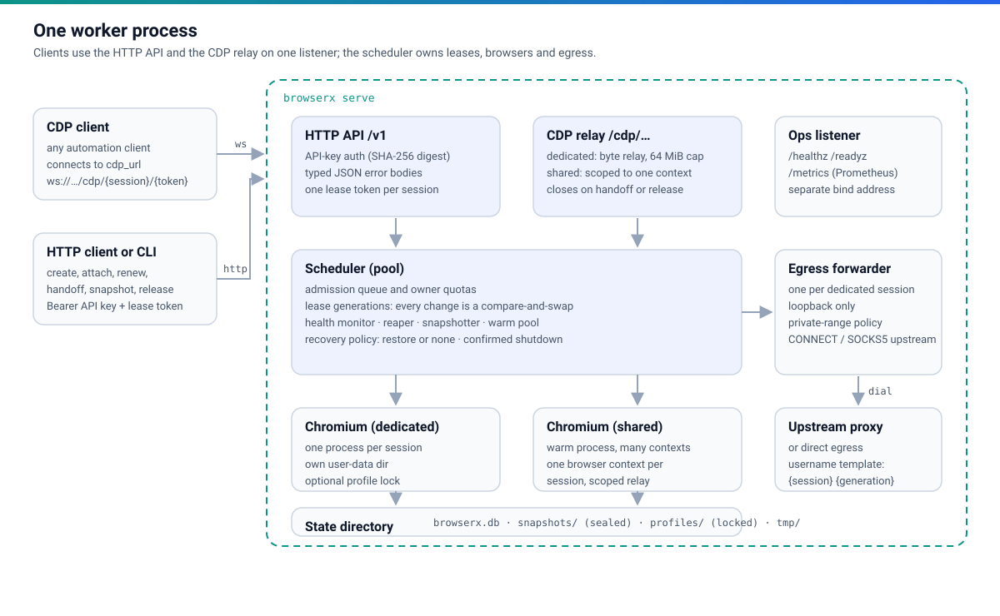

# Architecture

BrowserX is one Rust process, the *worker*, that supervises Chromium processes on the machine it runs on and exposes them to clients as leased sessions. This page describes the parts, how a request moves through them and where the boundaries are.

  <picture>
    <source media="(prefers-color-scheme: dark)" srcset="../assets/architecture-dark.svg">
    
  </picture>

## Components

| Component | Crate | Role |
| --- | --- | --- |
| Vocabulary | `browserx-core` | Identifiers, [`SessionSpec`](sessions-and-leases.md#the-session-spec), the lease record and its state machine, the snapshot format, the storage and runtime traits, one typed error enum with stable codes |
| CDP client | `browserx-cdp` | A bounded Chrome DevTools Protocol client the worker uses to talk to its own browsers: command timeout, maximum message size, maximum pending commands, bounded event buffer |
| Runtime | `browserx-runtime` | Launches Chromium, drains its output, probes health, creates and disposes browser contexts, captures and restores state, shuts a browser down and confirms the process is gone |
| Egress | `browserx-egress` | A per-session HTTP proxy on loopback that dials the network on the browser's behalf and applies destination policy |
| Stores | `browserx-store` | The lease registry (in memory or SQLite) and the snapshot store (in memory or sealed files), plus the AES-256-GCM sealer |
| Scheduler | `browserx-pool` | Admission, allocation, renewal, expiry, health monitoring, recovery, handoff, snapshots, warm pool |
| Server | `browserx-server` | The HTTP API, the CDP relay and the ops listener |
| Binary | `browserx` | `serve`, `doctor`, key tools, `config check` and the client commands |

The runtime is a trait (`BrowserRuntime`, `BrowserHandle`). The scheduler never launches a process itself, so a different browser provider can be added by implementing the two traits; see [launch profiles](../guides/launch-profiles.md) for the supported way to change *which* Chromium runs.

## Two listeners

| Listener | Config key | Default | Serves |
| --- | --- | --- | --- |
| Public | `server.listen` | `127.0.0.1:7690` | `/v1/...` JSON API and `/cdp/{session}/{token}` WebSocket relay |
| Ops | `server.ops_listen` | `127.0.0.1:7691` | `/healthz`, `/readyz`, `/metrics` |

They are separate so that probes and metrics scraping can be reachable by your orchestrator without being reachable by clients, and the other way round.

## Life of a request

1. **Authenticate.** The API key in `Authorization: Bearer` is hashed with SHA-256 and compared in constant time to the digests in `[[auth.api_keys]]`. The key's `name` becomes the *owner* of everything it creates.
2. **Admit.** `POST /v1/sessions` validates the [session spec](sessions-and-leases.md#the-session-spec), applies server bounds (time-to-live defaults and maximums), checks the owner's `max_sessions` and joins a bounded FIFO queue. If a browser cannot be provided before `queue_timeout_secs`, the answer is `429 capacity`.
3. **Allocate.**
   - *Dedicated isolation:* start a forwarder for the session (always: direct with the destination policy, or through the configured upstream), take the profile lock if the session uses a profile directory, restore the latest snapshot if the session uses snapshots, launch Chromium pointed at the forwarder.
   - *Shared isolation:* pick a warm shared browser that has a free context slot and create a browser context in it.
4. **Lease.** Insert the lease with generation 1, status `idle` and the SHA-256 digest of a fresh token. Only the digest is stored; the token goes back to the caller once.
5. **Attach.** The client opens the `cdp_url`. The relay checks the token digest and the lease, then connects the client to the browser (dedicated) or to a scoped view of its context (shared); both pass the host-protection rules (no `file:` navigation, no per-context proxy, confined downloads). The first attach after creation reports the `outcome` of how the session got its browser.
6. **Operate.** The client renews the lease, takes snapshots, disconnects and reconnects. Background tasks watch the browser, the clock and the snapshot schedule.
7. **Release.** `DELETE` (or expiry) moves the session through `draining`: final snapshot for snapshot sessions, dispose of the context or confirmed shutdown of the process, release of the profile lock, then `closed`.

## Background tasks

| Task | What it does | Bounded by |
| --- | --- | --- |
| Health monitor | Probes every browser with a protocol round trip; after `unresponsive_strikes` consecutive failures or on process exit, starts [recovery](recovery.md) | `health.probe_interval_secs`, `health.probe_timeout_ms` |
| Reaper | Releases sessions past their time-to-live or absolute lifetime, and sessions that sat without a controller longer than their idle timeout; finishes leases stranded in `draining` or `recovering`; purges terminal leases after the retention window | `session.*` |
| Snapshotter | Writes a snapshot of every `snapshot` session each `snapshot_interval_secs`, guarded by the generation so a superseded writer is discarded; prunes to `snapshot_keep` | `session.snapshot_interval_secs`, `session.snapshot_keep` |
| Warm pool | Keeps `warm_shared_browsers` idle shared browsers ready and retires browsers by age or by number of contexts served once they are empty | `pool.*` |

## Failure domains

| What fails | What is lost | What happens |
| --- | --- | --- |
| One dedicated browser | That session's in-memory page state | Recovery relaunches it; the next attach reports what was restored |
| One shared browser | Every context in it | Every session in it recovers independently |
| The worker process | Browsers it supervised keep running in their own process groups, so the next worker kills the ones it can verify and removes their temporary directories ([orphan sweep](recovery.md#startup-reconciliation)) | On start, leases found in non-terminal states are orphaned and are recovered or marked `lost` per their recovery policy; see [startup reconciliation](recovery.md#startup-reconciliation) |
| The state directory | Leases, snapshots, profiles | Back it up; see [operations](../guides/operations.md#backups) |
| A client | Nothing server-side | The lease continues until it expires; another client can attach with the token |

## Bounds

Everything that can grow has a limit: the admission queue (`queue_capacity`), concurrent browsers (`max_browsers`), contexts per shared browser, sessions per owner, CDP message size (64 MiB dedicated, 16 MiB shared by default), relay connections per session, listener connections and request-head time, pending CDP commands and buffered events, forwarder header size and connection count, labels per session and snapshot size per origin. [Configuration](../guides/configuration.md) lists the ones you can change.

## Concurrency model

The worker is a Tokio program. Lease changes are *load, modify, compare-and-swap on the expected generation*; no lock is held across an `.await`, and a lost swap surfaces as `stale_generation` (HTTP `409`) or is retried where retrying is safe. Channels between tasks are bounded. Blocking storage calls run on the blocking pool.
